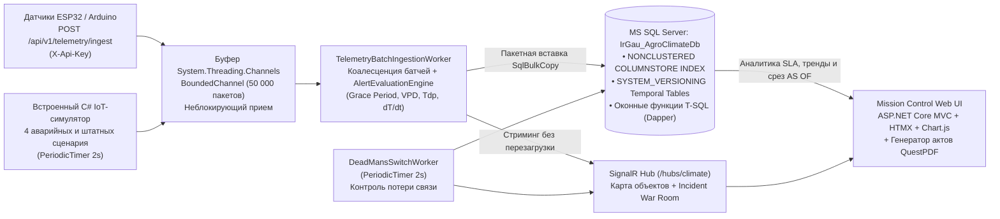

# AgroClimate War Room — Система телеметрии микроклимата, раннего обнаружения аномалий и управления инцидентами (ИрГАУ)

Промышленно-научная система мониторинга микроклимата, предиктивного выявления климатических угроз и оперативного управления авариями (**Incident War Room**), разработанная для тепличных комплексов, биолабораторий, овощехранилищ и зерноскладов **ФГБОУ ВО «Иркутский государственный аграрный университет им. А.А. Ежевского» (ИрГАУ)** и агропредприятий Восточной Сибири.

---

## Ключевые параметры развертывания

| Параметр | Значение |
| :--- | :--- |
| **Расположение решения** | `C:\Portfolio\AgroClimate\AgroClimate.sln` |
| **Платформа** | `.NET 10` (`ASP.NET Core MVC`, `SignalR`, `HTMX`, `C# 14`) |
| **СУБД** | `MS SQL Server` (`IrGau_AgroClimateDb`) |
| **Веб-порт** | `http://localhost:5102` |
| **Репозиторий** | `https://github.com/egorindza/AgroClimate` |

---

## Архитектура потоковой обработки телеметрии

Система спроектирована по принципам **Clean Architecture** и разделяет высокоскоростной прием пакетов от микроконтроллеров ESP32/STM32 и пакетную аналитическую запись в MS SQL Server:



### Слои решения (`AgroClimate.sln`)

1. **`AgroClimate.Domain`** — ядро предметной области без внешних инфраструктурных зависимостей:
   - сущности `ClimateZone`, `AgroProfile`, `TelemetryReading`, `Incident`, `IncidentChecklistItem`, `IncidentTimelineEvent`, `ApiKeyCredential`;
   - агрофизический калькулятор `AgroPhysicsCalculator`: расчет точки росы ($T_{dp}$) по формуле Магнуса–Тетенса (WMO / Alduchov–Eskridge, точной при сибирских морозах до $-45^\circ\text{C}$), дефицита упругости водяного пара ($VPD$, кПа) по уравнению Тетенса, риска выпадения конденсата и динамического таймера выживания культуры;
   - строгая машина состояний жизненного цикла инцидента (`Open` $\rightarrow$ `Acknowledged` $\rightarrow$ `Mitigating` $\rightarrow$ `Resolved`) с расчетом метрик реакции `MTTA` и устранения `MTTR`.
2. **`AgroClimate.Application`** — сценарии использования, потокобезопасный движок правил тревог `AlertEvaluationEngine` (контроль `GracePeriodSeconds`, мгновенная эскалация `Emergency`, детектор скоростного тренда `°C/мин`), контракты сервисов и строгие иерархические валидаторы `FluentValidation`.
3. **`AgroClimate.Infrastructure`** — инфраструктурный контур:
   - неблокирующий буфер `TelemetryChannelBuffer` (`System.Threading.Channels`) + фоновый воркер `TelemetryBatchIngestionWorker` с пакетной записью через `Microsoft.Data.SqlClient.SqlBulkCopy`;
   - `EF Core` (миграции, конфигурация `SYSTEM_VERSIONING = ON` Temporal Tables и `NONCLUSTERED COLUMNSTORE INDEX`) + высокоскоростной аналитический слой на `Dapper`;
   - фоновый сторожевой детектор обрыва связи `DeadMansSwitchWorker` на `PeriodicTimer`;
   - встроенный управляемый **IoT-симулятор на C#** (`IoTSimulatorWorker`);
   - генератор официальных инженерно-агрономических PDF-актов расследования инцидентов на **`QuestPDF`** (`PostmortemPdfService`) с поддержкой кириллицы и историческим срезом норм на момент аварии.
4. **`AgroClimate.Web`** — диспетчерский интерфейс **Mission Control** (`ASP.NET Core MVC` + `HTMX` + `SignalR` + `Chart.js`), переключение темной и светлой темы, быстрый демо-вход по 3 ролям в 1 клик и промышленный REST API шлюз для микроконтроллеров ESP32/Arduino.
5. **`AgroClimate.Tests`** — модульные и интеграционные тесты `xUnit` агрофизических расчетов, правил `Grace Period`, эскалации аномалий, буфера `Channels`, валидаторов и генерации `QuestPDF`.

---

## Продвинутые возможности MS SQL Server

1. **`NONCLUSTERED COLUMNSTORE INDEX` (`NCCI_TelemetryReadings_Analytics`)** на таблице временных рядов `dbo.TelemetryReadings` — обеспечивает мгновенное агрегирование десятков тысяч и миллионов измерений при расчете климатического SLA и построении графиков без блокировки оперативной пакетной вставки `SqlBulkCopy` (режим Real-Time Operational Analytics / HTAP).
2. **`Temporal Tables` (`SYSTEM_VERSIONING = ON`)** для таблицы `dbo.AgroProfiles` (с системной таблицей истории `dbo.AgroProfilesHistory`) — позволяет выполнять:
   - полный аудит `FOR SYSTEM_TIME ALL` в конструкторе агро-профилей (кто, когда и какие пороги изменял);
   - точечный исторический запрос `FOR SYSTEM_TIME AS OF @IncidentOpenedAtUtc` в комнате инцидента и в PDF-акте Postmortem, доказывающий, какие именно нормы действовали в секунду возникновения аварии.
3. **Оконные функции T-SQL (`LAG`, `FIRST_VALUE`, `AVG`, `STDEV`)** в Dapper-сервисе `DapperTelemetryAnalyticsService`:
   - радар скользящего окна `OVER (PARTITION BY ZoneId ORDER BY RecordedAtUtc ROWS BETWEEN 19 PRECEDING AND CURRENT ROW)` выявляет стремительное падение температуры при обрыве контура отопления еще **до** пересечения критического нуля, а также взвешивает реальные интервалы между пакетами через `LAG` для точного расчета `% времени в зеленой зоне (SLA)`.

---

## Объекты ИрГАУ и встроенные сценарии живого демо

При первом старте автоматический `AgroClimateDataSeeder` разворачивает 5 объектов ИрГАУ, 48 часов истории телеметрии в Columnstore и учебные расследованные инциденты:
1. **Теплица №1 — Рассада томата «Сибирский скороспелый F1»** (Учхоз «Оёкское» ИрГАУ)
2. **Сити-ферма микрозелени** (Агробиотехнопарк ИрГАУ, п. Молодёжный)
3. **Овощехранилище семенного картофеля «Сарма»** (Хранилищный комплекс учхоза)
4. **Зерносклад учхоза — Силос яровой пшеницы «Ирень» №2** (контроль самосогревания насыпи)
5. **Климатическая камера биолаборатории КК-4** (клональное микроразмножение *in vitro*)

Прямо с главного экрана Mission Control в 1 клик запускаются **4 сценария встроенного C# IoT-симулятора**:
- **Штатная работа всех объектов** — плавная стабилизация микроклимата в зеленых коридорах;
- **Ночной заморозок в Иркутске (-36°C) и отказ контура обогрева в Теплице №1** — стремительное падение $T^\circ$, сближение с точкой росы $T_{dp}$ и автоматическое открытие комнаты инцидента;
- **Очаг самосогревания и рост влажности в силосе пшеницы №2** — разогрев ядра зерновой насыпи и скачок дыхательного $\text{CO}_2 > 2000\text{ ppm}$;
- **Обрыв связи / зависание контроллера овощехранилища (Dead Man's Switch)** — прекращение пакетов от `ESP32-POTATO-03` и срабатывание фонового детектора потери сигнала через ~10 секунд.

---

## Запуск и проверка

```powershell
cd C:\Portfolio\AgroClimate

# Сборка и прогон всех автотестов xUnit
dotnet build AgroClimate.sln
dotnet test AgroClimate.sln

# Запуск веб-сервера Mission Control (порт 5102)
dotnet run --project src/AgroClimate.Web/AgroClimate.Web.csproj
```

После запуска откройте в браузере **`http://localhost:5102`**.

### Пример отправки телеметрии с контроллера ESP32 / `curl`

```bash
curl -X POST "http://localhost:5102/api/v1/telemetry/ingest" \
  -H "Content-Type: application/json" \
  -H "X-Api-Key: IRGAU-ESP32-GH1-DEMO-2026" \
  -d '{"sensorCode":"ESP32-GH1-01","temperatureC":22.8,"humidityPercent":67.5,"co2Ppm":740}'
```
